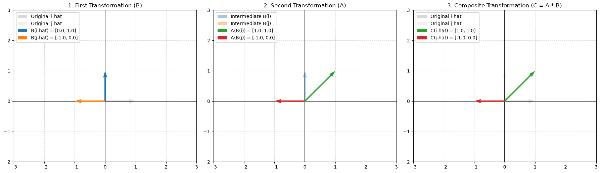

# 04. Matrix Multiplication as Composition

This module explores matrix multiplication from first principles using standard Python data structures (`list[float]`) without relying on external numerical acceleration libraries like NumPy. Inspired by 3Blue1Brown's *Essence of Linear Algebra*, it treats matrix multiplication $C = A \cdot B$ not as a raw arithmetic rule, but as the **composition of two sequential linear transformations**: applying transformation $B$ first, followed by transformation $A$.

---

## 📌 Implemented Core Concepts

### 1. Matrix Composition (`matrix_multiply`)

- **Mathematical Concept:** Computes the composite matrix $C = A \cdot B$ representing two successive linear transformations applied in right-to-left order (first $B$, then $A$).
- **Geometric View:** 
  1. Matrix $B$ transforms the original basis vectors $\hat{i}$ $[1, 0]$ and $\hat{j}$ $[0, 1]$ to intermediate landing spots $B(\hat{i})$ and $B(\hat{j})$.
  2. Matrix $A$ transforms those intermediate landing spots to their final positions $A(B(\hat{i}))$ and $A(B(\hat{j}))$.
  3. The resulting composite matrix $C$ directly maps the original basis vectors to their final landing sites in a single step.
- **Formula:**

$$C = A \cdot B = \begin{bmatrix} a & b \\ c & d \end{bmatrix} \begin{bmatrix} e & f \\ g & h \end{bmatrix} = \begin{bmatrix} a e + b g & a f + b h \\ c e + d g & c f + d h \end{bmatrix}$$

---

### 2. 3-Panel Geometric Visualizer (`visualization.py`)

- **Subplot 1 (First Transformation $B$):** Displays the initial basis vectors ($\hat{i}$ and $\hat{j}$) alongside their intermediate landing positions after applying transformation $B$ (e.g., $90^\circ$ CCW Rotation).
- **Subplot 2 (Second Transformation $A$):** Illustrates transformation $A$ (e.g., Horizontal Shear) being applied directly onto the intermediate basis landings $B(\hat{i})$ and $B(\hat{j})$.
- **Subplot 3 (Composite Transformation $C = A \cdot B$):** Shows the direct mapping from the original basis vectors to their final resting positions, proving visually that $C(\vec{v}) = A(B(\vec{v}))$.
- Saves the resulting 3-panel figure under `assets/matrix_composition.png`.

---

## 📂 File Structure

```text
04-matrix-multiplication-as-composition/
├── assets/
│   └── matrix_composition.png  # Rendered 3-panel geometric plot
├── README.md                   # Documentation and conceptual guide
├── matrix_from_scratch.py      # Pure Python math implementation & tests
└── visualization.py            # 3-panel Matplotlib composition visualizer
```
## 🚀 How to Run

### 1. Test Core Operations

Run `matrix_from_scratch.py` to execute built-in unit tests for matrix composition:

```bash
python matrix_from_scratch.py

```

**Expected Output:**

```text
Matrix Composition (A * B) : [[19.0, 22.0], [43.0, 50.0]]
```

### 2. Render Vector Visualization

Run `visualization.py` to display and export the interactive 3-panel plot:

```bash
python visualization.py

```

---

## 🖼️ Geometric Visualization

Here is the 3-panel visualization demonstrating Matrix Multiplication as a sequence of geometric transformations ($90^\circ$ CCW Rotation followed by Horizontal Shear):

