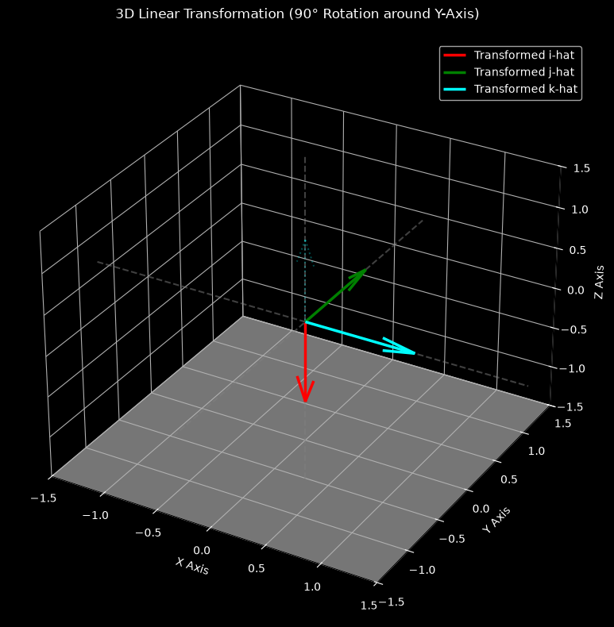

# 05: Three-Dimensional Transformations (3D Linear Transformations)

[](https://www.python.org/)
[](LICENSE)

This module extends linear transformation concepts from 2D space ($\mathbb{R}^2$) into 3D space ($\mathbb{R}^3$). It covers vector operations, $3 \times 3$ matrix-vector multiplication via linear combinations of column vectors, matrix composition, and Y-axis rotation matrices using pure Python without third-party mathematical libraries.

---

## 📌 Executive Summary & Theoretical Concepts

In 3D space, any point or vector is tracked using three standard basis vectors:
* $\hat{i} = [1, 0, 0]^T$ (X-axis, Red)
* $\hat{j} = [0, 1, 0]^T$ (Y-axis, Green)
* $\hat{k} = [0, 0, 1]^T$ (Z-axis, Cyan)

A 3D linear transformation is fully described by where these three basis vectors land after transformation. These landing positions form the columns of a $3 \times 3$ transformation matrix $A$:

$$A = \begin{bmatrix} \vert{} & \vert{} & \vert{} \\ T(\hat{i}) & T(\hat{j}) & T(\hat{k}) \\ \vert{} & \vert{} & \vert{} \end{bmatrix} = \begin{bmatrix} a & b & c \\ d & e & f \\ g & h & i \end{bmatrix}$$

---

## 🧮 Mathematical Formulations

### 1. Matrix-Vector Multiplication ($3 \times 3 \cdot 3 \times 1$)
Multiplying a $3 \times 3$ matrix $A$ by a vector $\vec{v} = [x, y, z]^T$ is computed as a **linear combination of matrix columns**:

$$A \vec{v} = x \cdot \begin{bmatrix} a \\ d \\ g \end{bmatrix} + y \cdot \begin{bmatrix} b \\ e \\ h \end{bmatrix} + z \cdot \begin{bmatrix} c \\ f \\ i \end{bmatrix}$$

### 2. Y-Axis Rotation Matrix
Rotating space counterclockwise around the Y-axis by an angle $\theta$ preserves the Y-coordinate while transforming the X and Z planes:

$$R_y(\theta) = \begin{bmatrix} \cos(\theta) & 0 & \sin(\theta) \\ 0 & 1 & 0 \\ -\sin(\theta) & 0 & \cos(\theta) \end{bmatrix}$$

---

## 📁 Module Structure

```text
05-three-dimensional-transformations/
├── matrix_from_scratch.py  # Pure Python 3D vector & 3x3 matrix logic
├── visualization.py        # Interactive 3D plot visualizer (3Blue1Brown style)
└── README.md               # Module documentation

```

---

## 🛠️ Implementation Details

### `matrix_from_scratch.py`

Contains foundational functions written from scratch with strict dimension validation and type hinting:

* `vector_add_3d(v1, v2)`: Component-wise addition of two 3D vectors.
* `scalar_multiply_3d(scalar, v)`: Scales a 3D vector by a scalar constant.
* `matrix_vector_multiply_3d(matrix, v)`: Transforms a 3D vector using column linear combinations.
* `matrix_multiply_3d(m1, m2)`: Computes 3D matrix composition $M_1 \cdot M_2$ by transforming columns of $M_2$ through $M_1$.
* `get_rotation_matrix_y(angle_rad)`: Generates a $3 \times 3$ Y-axis rotation matrix.

### `visualization.py`

Renders 3D standard basis vectors $(\hat{i}, \hat{j}, \hat{k})$ and their transformed positions using Matplotlib `mplot3d` with dark theme aesthetics:

* **Faint dashed arrows**: Original basis vectors before transformation.
* **Solid bold arrows**: Transformed basis vectors after $90^\circ$ Y-axis rotation.

---

## 🚀 How to Run

1. **Test Core Mathematical Functions:**
```bash
python 05-three-dimensional-transformations/matrix_from_scratch.py

```


2. **Launch 3D Interactive Visualization:**
```bash
python 05-three-dimensional-transformations/visualization.py

```
---

## 🖼️ Geometric Visualization

Below is the 3D visualization illustrating the transformation of standard basis vectors $(\hat{i}, \hat{j}, \hat{k})$ under a $90^\circ$ Y-axis rotation:

