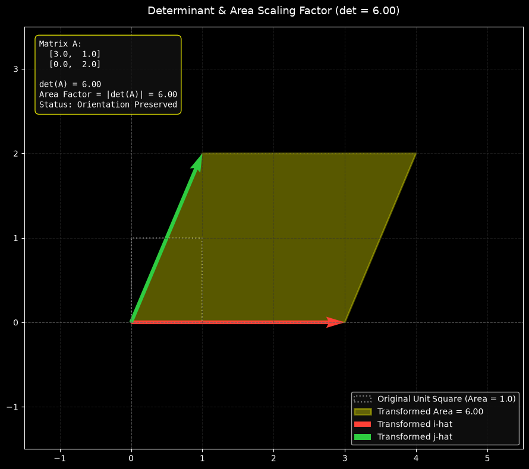

# Module 06: The Determinant & Area Scaling

[](https://www.python.org/)
[](LICENSE)
[](https://docs.python.org/3/tutorial/classes.html)

This module explores the geometric intuition behind the **determinant** of a linear transformation. Starting from this module, the codebase transitions from procedural functions to an Object-Oriented Programming (OOP) paradigm using a custom `Matrix` class, `@property` decorators, and encapsulated methods.

---

## 📌 Executive Summary & Theoretical Concepts

The determinant measures the exact factor by which a linear transformation scales area (in 2D space, $\mathbb{R}^2$) or volume (in 3D space, $\mathbb{R}^3$).

* **Unit Region Scaling**: Because linear transformations preserve evenly spaced grid lines, every region in space scales by the exact same factor as the unit square ($1 \times 1$).
* **Zero Determinant ($\det = 0$)**: Indicates a **dimensional collapse** (singularity). A 2D plane collapses onto a 1D line or 0D point, reducing the area of all shapes to zero.
* **Negative Determinant ($\det < 0$)**: Indicates an **orientation flip** (e.g., flipping space inside out like turning over a sheet of paper). The absolute value $\vert{}\det\vert{}$ still provides the spatial scaling factor.

---

## 🧮 Mathematical Formulations

### 1. $2 \times 2$ Determinant
For a $2 \times 2$ matrix $A$, the determinant is calculated as the difference between the main and anti-diagonal products:

$$\det(A) = \det \begin{bmatrix} a & b \\ c & d \end{bmatrix} = ad - bc$$

### 2. $3 \times 3$ Determinant (Cofactor Expansion)
For a $3 \times 3$ matrix, the determinant represents the volume of the resulting parallelepiped, calculated via first-row cofactor expansion:

$$\det \begin{bmatrix} a & b & c \\ d & e & f \\ g & h & i \end{bmatrix} = a(ei - fh) - b(di - fg) + c(dh - eg)$$

### 3. Product Rule
The determinant of a composed transformation equals the product of individual determinants:

$$\det(A \cdot B) = \det(A) \cdot \det(B)$$

---

## 🖼️ Geometric Visualization

Below is the geometric visualization demonstrating how a unit square transforms into a parallelogram under matrix $A = \begin{bmatrix} 3.0 & 1.0 \\ 0.0 & 2.0 \end{bmatrix}$, expanding its original area ($1.0$) by a scaling factor of $\det(A) = 6.0$:



---

## 📁 Module Structure

```text
06-the-determinant/
├── assets/
│   └── determinant_scaling.png  # Generated area scaling plot
├── matrix_from_scratch.py       # OOP Matrix class & determinant logic
├── visualization.py             # Matplotlib area visualizer & asset exporter
└── README.md                    # Module documentation

```

---

## 🛠️ Implementation Details

### `matrix_from_scratch.py`

Refactored into a custom `Matrix` class supporting 2D and 3D operations:

* **`Matrix(data)`**: Constructor initializing rows, columns, and internal validation.
* **`_validate()`**: Internal helper verifying valid $2 \times 2$ or $3 \times 3$ square grids.
* **`@property det`**: Dynamic property returning the determinant based on spatial dimension.
* **`@property is_singular`**: Evaluates whether $\vert{}\det\vert{} < 10^{-9}$ (dimensional collapse check).
* **`@property orientation_status`**: Tracks orientation preservation (`Preserved`, `Inverted`, or `Collapsed`).
* **`__repr__()`**: Clean Pythonic string representation for object logging.

### `visualization.py`

Visualizes transformation mechanics in 3Blue1Brown aesthetics:

* **Unit Square vs. Transformed Polygon**: Displays original $1 \times 1$ boundaries alongside the transformed parallelogram using `matplotlib.patches.Polygon`.
* **Transformed Basis Vectors**: Renders new landing positions of $\hat{i}$ (Red) and $\hat{j}$ (Green) arrows.
* **Dynamic Information Panel**: Displays input matrix $A$, $\det(A)$, area scaling factor, and orientation status.
* **Auto-Export**: Automatically saves output graphics to `assets/determinant_scaling.png`.

---

## 🚀 How to Run

1. **Test OOP Matrix Class Methods & Determinants:**
```bash
python 06-the-determinant/matrix_from_scratch.py

```


2. **Launch Interactive Area Scaling Visualization:**
```bash
python 06-the-determinant/visualization.py

```
## 🖼️ Geometric Visualization

Below is the visualization illustrating how a standard $1 \times 1$ unit region morphs into a transformed parallelogram, scaling its total area by a factor equal to the determinant $|\det(A)|$:


---
