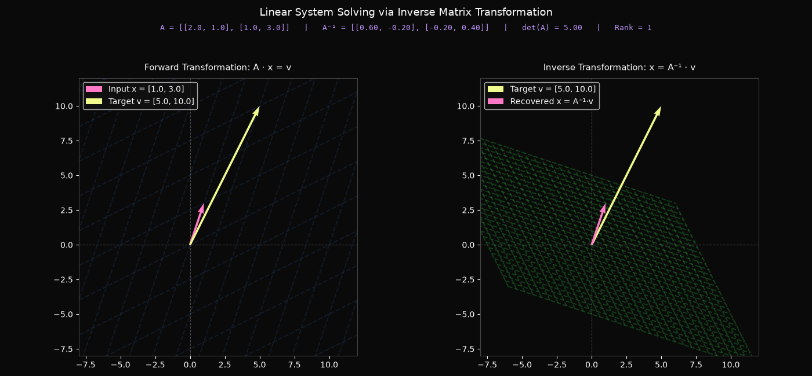

# Module 07: Inverse Matrices, Column Space, and Null Space

This module explores systems of linear equations ($A \mathbf{x} = \mathbf{v}$) and their solutions through the geometric lens of linear transformations. Building upon the OOP `Matrix` class introduced in Module 06, this module implements matrix inversion ($A^{-1}$), system solving, rank calculation, column space determination, and null space (kernel) basis extraction.

---

## 📌 Executive Summary & Theoretical Concepts

* **Linear Systems as Transformations**: Solving $A \mathbf{x} = \mathbf{v}$ means finding the input vector $\mathbf{x}$ that, after space is transformed by matrix $A$, lands directly on target vector $\mathbf{v}$.
* **Inverse Matrix ($A^{-1}$)**: Represents playing the transformation in reverse ("rewinding space"). An inverse exists if and only if $\det(A) \neq 0$.
* **Zero Determinant & Non-Invertibility**: When $\det(A) = 0$, space undergoes a dimensional collapse (to a line or point). No single function inverse can un-collapse a lower-dimensional output back into space, so $A^{-1}$ does not exist.
* **Rank & Column Space**: The **column space** is the set of all possible output vectors $A \mathbf{x}$ (the span of matrix columns). **Rank** measures the dimension of this column space ($2$ for full 2D rank, $1$ for collapse to a line, $0$ for zero matrix).
* **Null Space (Kernel)**: The set of all input vectors $\mathbf{x}$ that get squished down to the origin $\mathbf{0}$ ($A \mathbf{x} = \mathbf{0}$).

---

## 🧮 Mathematical Formulations

### 1. Matrix Inversion ($2 \times 2$)

For a non-singular $2 \times 2$ matrix $A = \begin{bmatrix} a & b \\ c & d \end{bmatrix}$, the inverse is given by:

$$A^{-1} = \frac{1}{\det(A)} \begin{bmatrix} d & -b \\ -c & a \end{bmatrix} = \begin{bmatrix} \frac{d}{ad-bc} & \frac{-b}{ad-bc} \\ \frac{-c}{ad-bc} & \frac{a}{ad-bc} \end{bmatrix}$$

### 2. System Solution via Inverse

Multiplying both sides of $A \mathbf{x} = \mathbf{v}$ by $A^{-1}$ yields:

$$\mathbf{x} = A^{-1} \mathbf{v}$$

### 3. Identity Property

Applying a transformation followed by its inverse leaves all basis vectors untouched:

$$A^{-1} A = I = \begin{bmatrix} 1 & 0 \\ 0 & 1 \end{bmatrix}$$

---

## 📁 Module Structure

```text
07-inverse-matrices-column-null-space/
├── assets/
│   └── linear_system_inverse.png   # Generated dual-panel inverse solution plot
├── matrix_from_scratch.py          # OOP Matrix class extension (inverse, solve, rank, null space)
├── visualization.py                # Matplotlib dual-panel visualizer & asset exporter
└── README.md                       # Module documentation

```

---

## 🛠️ Implementation Details

### `matrix_from_scratch.py`

Extended `Matrix` class supporting linear system operations and sub-space analysis:

* **`inverse()`**: Calculates $A^{-1}$ using the $2 \times 2$ adjugate matrix formula divided by $\det(A)$. Raises `ValueError` if `is_singular` is `True`.
* **`solve(v)`**: Computes the unique solution vector $\mathbf{x} = A^{-1} \mathbf{v}$ via matrix-vector multiplication.
* **`@property rank`**: Evaluates the dimension of the column space ($2$ for full rank, $1$ for singular non-zero matrix, $0$ for zero matrix).
* **`@property null_space_basis`**: Extracts normalized basis vector(s) spanning the kernel ($A \mathbf{x} = \mathbf{0}$).
* **`__repr__()`**: Clean Pythonic string representation for object logging.

### `visualization.py`

Visualizes forward and inverse system solving across a dual-panel canvas in 3Blue1Brown aesthetics:

* **Panel 1 (Forward Space $A \mathbf{x} = \mathbf{v}$)**: Renders the input vector $\mathbf{x}$ (Pink) transformed into target vector $\mathbf{v}$ (Yellow) over transformed grid lines.
* **Panel 2 (Reversed Space $\mathbf{x} = A^{-1} \mathbf{v}$)**: Renders target vector $\mathbf{v}$ being rewound back into solution vector $\mathbf{x}$ over inverted grid lines.
* **Dynamic Header Info**: Displays matrices $A$ and $A^{-1}$, $\det(A)$, and `Rank` without overlapping plot legends.
* **Auto-Export**: Automatically saves the rendered graphic to `assets/linear_system_inverse.png`.

---

## 🚀 How to Run

1. **Test OOP Matrix Inversion, System Solving, Rank, & Null Space:**

```bash
python 07-inverse-matrices-column-null-space/matrix_from_scratch.py

```

2. **Launch Dual-Panel Linear System Inverse Visualization:**

```bash
python 07-inverse-matrices-column-null-space/visualization.py

```

---

## 🖼️ Geometric Visualization

Below is the visualization illustrating how matrix $A$ transforms vector $\mathbf{x}$ into target $\mathbf{v}$ (left) and how the inverse matrix $A^{-1}$ rewinds space to recover $\mathbf{x} = A^{-1} \mathbf{v}$ (right):

