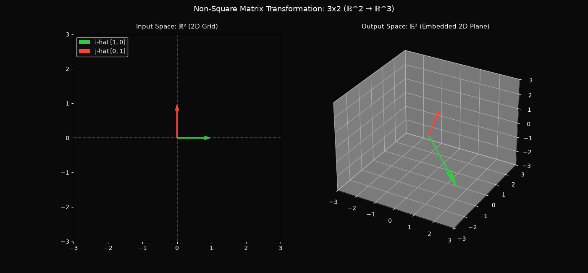

# Module 08: Non-Square Matrices as Transformations Between Dimensions

[](https://www.python.org/)
[](LICENSE)
[](https://docs.python.org/3/tutorial/classes.html)

This module explores linear transformations between different dimensions using non-square ($m \times n$) matrices. It extends the custom OOP `Matrix` class to handle arbitrary rectangular dimensions, mapping vectors between distinct input spaces ($\mathbb{R}^n$) and output spaces ($\mathbb{R}^m$).

---

## 📌 Executive Summary & Theoretical Concepts

- **Transformations Between Dimensions**: Unlike square matrices that transform space within the same dimension, non-square $m \times n$ matrices bridge distinct dimensional spaces.
- **Columns = Input Dimension ($n$)**: The number of columns represents the number of basis vectors in the input space ($\mathbb{R}^n$).
- **Rows = Output Dimension ($m$)**: The number of rows specifies the number of coordinates required to describe where each basis vector lands in the output space ($\mathbb{R}^m$).
- **Full Rank Non-Square Matrices**: A $3 \times 2$ matrix maps 2D input space into a 2D plane slicing through 3D output space (Rank 2). A $1 \times 2$ matrix squishes 2D space down onto a 1D scalar number line.

---

## 🧮 Mathematical Formulations

### 1. Matrix Structure ($m \times n$)
A matrix with $m$ rows and $n$ columns transforms vectors from $\mathbb{R}^n \rightarrow \mathbb{R}^m$:

$$A_{m \times n} = \begin{bmatrix} \vert & \vert & & \vert \\ T(\hat{i}) & T(\hat{j}) & \cdots & T(\hat{e}_n) \\ \vert & \vert & & \vert \end{bmatrix}_{m \times n}$$

### 2. Linear Combination of Columns
Transforming a vector $\mathbf{v} = [v_1, v_2, \dots, v_n]^T \in \mathbb{R}^n$ yields:

$$A \mathbf{v} = v_1 \mathbf{a}_1 + v_2 \mathbf{a}_2 + \dots + v_n \mathbf{a}_n \in \mathbb{R}^m$$

---

## 📁 Module Structure

```text
08-nonsquare-matrices/
├── assets/
│   └── nonsquare_transformation.png  # Exported 2D -> 3D transformation plot
├── matrix_from_scratch.py            # Extended m x n Matrix class
├── visualization.py                  # Side-by-side cross-dimensional visualizer
└── README.md                         # Module documentation
```

## 🛠️ Implementation Details

### `matrix_from_scratch.py`

Extended `Matrix` class for arbitrary $m \times n$ rectangular grids:

* **`shape`**: Property returning `(rows, cols)` tuple.
* **`input_dim`**: Returns $n$ (columns count).
* **`output_dim`**: Returns $m$ (rows count).
* **`multiply_vector(v)`**: Computes $A \mathbf{v}$ via linear combination of column vectors.
* **`multiply_matrix(other)`**: Handles matrix multiplication $A_{m \times n} \cdot B_{n \times p} \rightarrow C_{m \times p}$.

### `visualization.py`

Dual-panel Matplotlib visualizer showing cross-dimensional mappings:

* **Left Panel**: $2D$ input space with standard basis vectors $\hat{i}$ and $\hat{j}$.
* **Right Panel**: $3D$ output space displaying transformed basis vectors forming a 2D column space plane.
* **Auto-Export**: Saves output plot directly to `assets/nonsquare_transformation.png`.

---

## 🚀 How to Run

1. **Test Non-Square Matrix Logic & Multiplications:**

```bash
python 08-nonsquare-matrices/matrix_from_scratch.py

```

2. **Launch Cross-Dimensional Transformation Visualizer:**

```bash
python 08-nonsquare-matrices/visualization.py

```

---

## 🖼️ Geometric Visualization

Below is the visualization illustrating a $3 \times 2$ matrix transformation mapping 2D input space into a 2D plane embedded inside 3D space:
